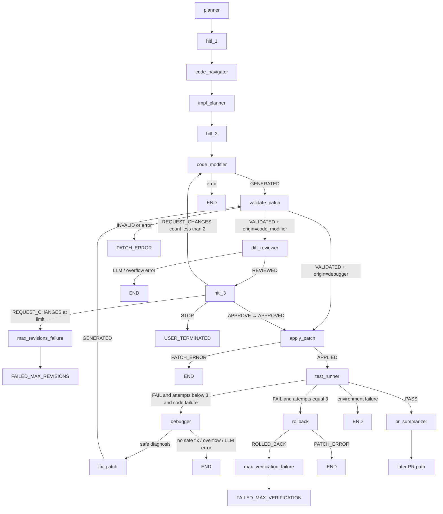

# Prism V2 — Graph (Phase 5 Diff Reviewer + HITL #3)

Phase 5 inserts an independent Diff Reviewer and HITL #3 approval gate on the **initial** Code Modifier path. Debugger-origin patches permanently bypass review (V2-ADR-008 / V2-ADR-026).

## Executable graph

`interrupt_before` is `["hitl_1", "hitl_2", "hitl_3"]`.

`fix_patch` remains Debugger recovery, **not** a ninth product agent.

## Patch origins

| Origin | After `VALIDATED` | Apply gate |
| --- | --- | --- |
| `code_modifier` | `diff_reviewer` → `hitl_3` | Requires `APPROVED` |
| `debugger` | `apply_patch` (bypass) | Allows `VALIDATED` |

`REVIEWED` is never applied. Reviewer `APPROVE` only means “ready for human gate”; human APPROVE is mandatory for initial patches.

## HITL #3 actions

| Action | Effect |
| --- | --- |
| `approve` | `patch_status=APPROVED` → Apply |
| `revise` | Requires non-empty `human_feedback` (422 otherwise). Persist `rejected_diff` + feedback; `REJECTED`; increment `hitl_revision_count`; resume Code Modifier if count ≤ 2 |
| `stop` | `session_status=USER_TERMINATED`; no Apply, no rollback |

Max revisions: `MAX_HITL_REVISIONS = 2`. Exceeding → `FAILED_MAX_REVISIONS` via `max_revisions_failure` (no Code Modifier, no Apply, no rollback).

## Counters (independent)

- `verification_attempts` — Test Runner executions only (Phase 4). Hard max 3.
- `hitl_revision_count` — HITL #3 REQUEST_CHANGES only (Phase 5). Hard max 2. Starts at 0; increments on revise (`0→1→2`).

## Revision → Code Modifier

When revising, Code Modifier receives `implementation_plan` + repo context + `rejected_diff` + `reviewer_findings` + `human_patch_feedback` + revision number. New patches reset lifecycle to `GENERATED` (cannot inherit `APPROVED` / `REVIEWED`).

## Terminal states (Phase 5 additions)

| Outcome | `session_status` | Notes |
| --- | --- | --- |
| HITL #3 STOP | `USER_TERMINATED` | Distinct from max-revision / verification failure |
| HITL revision limit | `FAILED_MAX_REVISIONS` | After 2 REQUEST_CHANGES cycles |
| Reviewer LLM / overflow | `LLM_ERROR` / `CONTEXT_OVERFLOW` | Never invents APPROVE; never reaches HITL #3 |

## Out of scope

Phase 6 eval, Phase 7 polish, SSE/WebSockets redesign, Debugger redesign, reviewer auto-apply.
