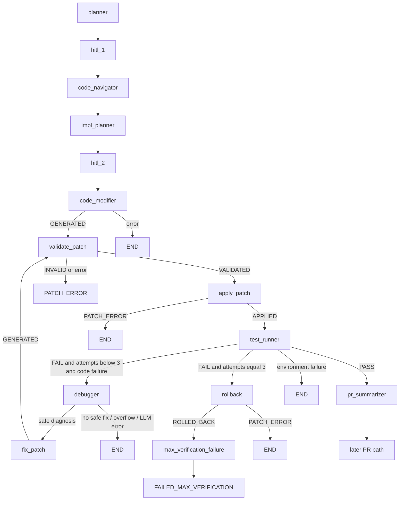

# Prism V2 — Graph (Phase 4 executable adapter)

Phase 4 implements the verification / self-correction half of the V2 loop as a **staged adapter**. Diff Reviewer, HITL #3, revision cycles, and `SUCCESS` on test PASS are **not** implemented. See [V2-ADR-025](DECISIONS_V2.md).

## Executable graph



`interrupt_before` remains `["hitl_1", "hitl_2"]`. There is no `diff_reviewer` or `hitl_3` node.

`fix_patch` is Debugger recovery, **not** a ninth product agent.

## Verification attempts

A verification attempt is **one Test Runner execution** against the current applied workspace.

- `PrismState.verification_attempts` starts at `0`.
- Test Runner increments **immediately before** execution (`backend/verification.py`).
- First post-apply run is attempt `1`. Hard max `3`. No fourth run.
- Debugger, Fix Patch, Apply, and Validate do **not** increment.
- `hitl_revision_count` is independent and unused by this loop.

## PASS / FAIL

PASS only when at least one test was collected, zero failures, and `exit_code == 0`. `framework="skipped"` is never PASS. The LLM cannot override this.

On PASS: `patch_status=VERIFIED`, `session_status` stays `RUNNING`. The session is **not** marked `SUCCESS` (that remains the later PR path).

## Debug fixes bypass HITL #3

Debug patch lifecycle:

```text
GENERATED → VALIDATED → APPLIED → (Test Runner PASS) VERIFIED
```

`REVIEWED` and `APPROVED` are skipped. Apply already accepts `VALIDATED`.

## Cumulative patches

Apply always clones a clean tree at `baseline_sha`. Every `current_patch.unified_diff` is the full `baseline_sha → desired state` diff. Fix Patch uses `generate_cumulative_structured_patch`: materialize the previous patch, apply a focused spec, then `diff` against `baseline_sha`. `baseline_sha` never changes.

## Terminal states (Phase 4)

| Outcome | `session_status` | `patch_status` |
| --- | --- | --- |
| Tests PASS | `RUNNING` (not `SUCCESS`) | `VERIFIED` |
| Attempt 3 FAIL + rollback OK | `FAILED_MAX_VERIFICATION` | `ROLLED_BACK` |
| Attempt 3 FAIL + rollback fail | `PATCH_ERROR` | unchanged / not `FAILED_MAX_VERIFICATION` |
| Debugger/Fix/overflow/LLM | existing terminals | as today |

`rollback` is a Phase 3 primitive and does not write `FAILED_MAX_VERIFICATION`. `max_verification_failure` does that only after verified rollback.

## Environment vs code failures

- Code (`assertion`, `compile`, `import`, `empty_collection`, `unknown`) with attempts `< 3` → Debugger.
- Attempt 3 code FAIL → Rollback (never Debugger).
- Environment (`sandbox`, `command_not_found`, `timeout`) → persist `error`, map DB `failed`, END. No Debugger. No `FAILED_MAX_VERIFICATION`.

## Out of scope

Diff Reviewer, HITL #3, REQUEST_CHANGES, USER_TERMINATED, Phase 6 eval, Phase 7 polish.
